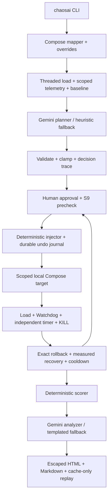

# ChaosPilot

AI-driven chaos engineering for cloud-native resilience, built for the Bosch hackathon.
The Python package `chaosai` maps a Compose application, measures a baseline, proposes faults,
asks for approval, injects within a deterministic safety boundary, measures impact/recovery,
and produces a reproducible findings report. Gemini explains evidence; Python controls faults
and computes scores. No agent framework is used.

**Feature freeze:** Phases 0–10 implementation is available. Live resilience verification is
partial. The target is currently **unassessed**. The measured attempt `20261011-014810` injected
zero faults after auth HTTP 429s blocked readiness and cooldown; smoke failed at admin login.
Its `stable=true` baseline is error-contaminated. Historical `20261011-011425` stays
`stable=false`. Synthetic fixture scores 53/17/95 (overall 55, weak) describe examples only.
See [progress](docs/progress.md), [remaining verification](docs/final-verification.md) and the
[pending measured sample deliverable](examples/sample-run/README.md).



## Prerequisites and deployment

macOS with Docker Desktop and Docker Compose v2, Git, Python >=3.11, and a local isolated
sandbox. POSIX locks also work on Linux; Windows is not verified. Bootstrap needs package
index access. Live target builds need image/npm access and sufficient RAM/ports for ten
containers. The frontend defaults to localhost:3000, auth:3004, product:3002, order:3003;
source deployment details are in [target notes](docs/target-notes.md).

Target: [andrelima28439/ecommerce-microservices](https://github.com/andrelima28439/ecommerce-microservices),
a public MIT-licensed third-party repository. Source observations are pinned to revision
`bae94402773bc7fd7d05dadd4062dffe2d1c2057`. Keep its source read-only. `--clone` below checks
out that revision under `chaos-ai/.chaosai/target-source`; it never overwrites the sibling.
The target's service entrypoints perform schema pushes, so Compose bring-up is not a data reset.
Volumes and previous evidence are retained. Fixed container names/ports prevent parallel
copies of this target; use one configured sandbox at a time.

Run from the `chaos-ai` directory:

```sh
bash scripts/bootstrap.sh
source .venv/bin/activate
python -m chaosai run --offline --yes
python -m chaosai run --offline --dry-run
```

Bootstrap creates `.venv` and installs the project with development tools. Use
`PYTHON=/path/to/python3.11 bash scripts/bootstrap.sh` to select an interpreter. Offline
needs no target or credentials: no Docker, HTTP, dotenv read, real model or wait occurs.
It writes **synthetic** artifacts under `runs/<UTC-run-id>/` and prints the report path.

For live reproduction, configure `chaos-ai/.env` yourself using the variable names below
(or export them). Keep keys/passwords private. Existing admin/load accounts need their current
`ADMIN_PASSWORD`/`SEED_PASSWORD`; seed verifies them and never resets them. `LLM_PROVIDER=none`
uses heuristics/fallbacks; doctor still checks key and dotenv presence, as documented below.

```sh
# Reuse TARGET_DIR from process configuration / local .env / the sibling default:
bash scripts/clean_run.sh
# Alternative on a machine without the target checkout (destination must not exist):
bash scripts/clean_run.sh --clone
```

These are **human-only live commands**. They bootstrap, reject KILL/pending undo/active
injectors before bring-up, use scoped `chaosai up` (Compose up -d --build), doctor, seed, smoke,
`run --yes --max-experiments 4`, validate evidence and run final smoke. No prune, volume
removal, destructive reset or automatic KILL clear. Script failure retains journals and
reports. A zero exit requires a clean baseline and at least four completed, recovered measured
experiments across three fault types; safety demonstrations and visual review remain separate.
The auth budget and sparse recovery may prevent this even on a running app. See the full
[verification checklist](docs/final-verification.md) before running it; do not run live load
commands concurrently. Waiting alone does not prove readiness.

No payment patch exists: the inspected placeholder Stripe path already bypasses payment.
Live checkout creates a **pending order**, not payment completion; configured real keys may
activate target-owned external calls. Resend/Cloudinary/Stripe are never injectable. If a
confirmed target defect needs a patch, store it under `patches/`, document provenance and an
`apply_patches.sh`/`revert_patches.sh` flow, and apply only to the owned clone. Clean-run refuses
patches on an existing source checkout and refuses patch files without that documented helper.
No patch is justified by the observed auth rate limiting.

## Command reference

Use `chaosai --help` and `chaosai <command> --help`. The console command and
`python -m chaosai` are equivalent after activation. Paths/IDs below are placeholders to
replace with the path actually printed by the CLI.

| Command | Behavior / available options |
|---|---|
| `chaosai doctor [--llm]` | Scoped state/ports/public GETs, Python/key/dotenv presence. `--llm` explicitly probes validated JSON. |
| `chaosai up` | Scoped Compose build/start; refuses KILL/pending undo/active injectors and holds locks through bring-up. Startup is not readiness. |
| `chaosai status` | Only configured project containers, state/health/ports. |
| `chaosai seed [--users N]` | Idempotent accounts/admin/catalog; scoped credential and DB checks. |
| `chaosai smoke` | Browse/login/create/retrieve; best-effort queue/consumer evidence. Creates an order. |
| `chaosai map [--mermaid] [--offline] [--run-dir PATH]` | Compose/overrides or packaged graph; no Docker/network/dotenv. `--run-dir` needs an existing directory in runs/. |
| `chaosai load [--users N] [--duration SECONDS]` | Threaded real HTTP requests; creates orders. |
| `chaosai baseline [--quick] [--duration SECONDS]` | Full 30s warm-up/120s measurement; quick 10s/40s. Saves run/latest evidence. |
| `chaosai plan [--offline]` | Reasons and requested/final/clamp trace; live uses a saved baseline and may call Gemini, no injection/load. |
| `chaosai fault apply FAULT TARGET [--duration SECONDS] [--yes]` | Low-level kill/stop/pause (CPU default intensity subject to exact restore); no load/metric Watchdog. Traffic requires measured run. |
| `chaosai fault undo FAULT TARGET` | Replay matching scoped container undo records. |
| `chaosai inject FAULT TARGET [--duration SECONDS] [--abort-error-rate RATE] [--yes]` | One measured kill/stop/pause with saved baseline, S9, Watchdog and recovery. |
| `chaosai run [--offline] [--yes] [--dry-run] [--max-experiments N] [--reuse-baseline]` | Ranked sequential plan, 1–8 selected entries. Reuse needs stable baseline <1h old. Live dry-run may generate baseline load. |
| `chaosai rollback [--clear-kill]` | Replay all journals; explicit clear only after successful undo and injector exit. |
| `chaosai kill` | Persist KILL then directly replay journals; use another terminal during an active fault. |
| `chaosai report PATH_OR_ID` | Regenerate HTML/Markdown from saved data, no LLM/target. |
| `chaosai replay PATH_OR_ID` | Recompute analysis using exact validated response caches; misses use fallback; no network/target/dotenv. |

Execution defaults to `[y]es / [n]o skip / [a]ll remaining / [q]uit`, showing the fault,
hypothesis, abort limits and clamps. Without a TTY and without `--yes`, injection is refused.
`--max-experiments 4` selects four entries; skips/refusals consume slots and do not count as
completed experiments. See [experiments](docs/experiments.md) and [safety](docs/safety.md).

## Configuration

`chaosai/config.py` defines defaults. Process variables override local dotenv; offline,
mapping and replay skip dotenv. Never commit local `.env`, keys, passwords or raw logs.

| Variables | Purpose / defaults |
|---|---|
| `TARGET_DIR`, `COMPOSE_PROJECT` | Sibling `../ecommerce-microservices`, project `ecommerce-microservices`; relative paths resolve from chaos-ai. |
| `LLM_PROVIDER`, `GEMINI_MODEL`, `LLM_TIMEOUT_S` | gemini/mock/none; automatic model resolution unless overridden; 30s requests. Provider auto-selects Gemini when a key exists, otherwise none. |
| `GEMINI_API_KEY`, `GOOGLE_API_KEY` | Private process/key configuration; presence only is shown. Never printed or saved. |
| `FRONTEND_URL`, `AUTH_URL`, `PRODUCT_URL`, `ORDER_URL` | Local published bases as listed above; no `/api` prefix. |
| `RABBITMQ_MANAGEMENT_URL`, `RABBITMQ_USER`, `RABBITMQ_PASSWORD`, `RABBITMQ_VHOST` | Management queue observation; configure privately when defaults differ. |
| `SEED_USERS`, `SEED_PASSWORD`, `ADMIN_PASSWORD` | 20 accounts; existing passwords must match. Unset admin password uses seed password. |
| `AUTH_TIMEOUT_S`, `REQUEST_TIMEOUT_S` | 4s auth (3–5 permitted), 10s management/setup HTTP. |
| `LOAD_USERS`, `LOAD_DURATION_S`, `LOAD_TIMEOUT_S` | 10 workers, 30s standalone load, 5s requests (maximum 5). |
| `CHECKOUT_RPS`, `LOGIN_RATE_CAP`, `TOKEN_REFRESH_S` | Shared caps 1/s and 1/s per generator, token renewal 600s (maximum 600). |
| `THINK_MIN_S`, `THINK_MAX_S` | 0.2–1.0s worker think time; endpoints constrained to that range. |
| `WARMUP_S`, `BASELINE_DURATION_S`, `METRICS_INTERVAL_S` | 30s/120s baseline; 5s ordinary telemetry, 1s experiment telemetry. |
| `NOTIFICATION_INTERVAL_S` | 6s between three best-effort queue/log observations. |
| `DOCKER_HOST`, `DOCKER_TLS_VERIFY`, `DOCKER_CERT_PATH` | SDK environment; otherwise active CLI context, Desktop socket, system socket. |

Ordinary doctor makes no LLM request but requires key/dotenv presence for its complete PASS
result. Live run's doctor-lite checks target readiness without requiring a key. This historical
readiness diagnostic distinction is retained. [Load/baseline semantics](docs/load-baseline.md)
cover request-level samples, low-sample flags and the shared target auth limiter.

## Safety S1–S10

| Rule | Deterministic boundary |
|---|---|
| S1 | Graph eligibility and exact `com.docker.compose.project` label checked before access/mutation; external services denied. |
| S2 | Duration 5–120s; CPU 0.1–0.5; traffic 2–8×, <=150 workers; abort errors 0.05–0.9/p95 2–20×; one fault, <=8 entries. All clamps traced. |
| S3 | Original identity/state and undo action atomically written and fsynced before mutation. |
| S4 | Replay on every exit and before new injection. Retain failed undo; never repair unrelated unjournaled failures. |
| S5 | Independent 1s Watchdog: adaptive 5–20s windows, aggregate for sparse journeys, 5s grace, >=10 samples/two breaches by default; immediate blast-radius stop. |
| S6 | Measured runner has an independent pre-apply duration timer; bounded in-flight SDK calls can delay actual restoration. |
| S7 | KILL polled every 0.5s; second-terminal kill persists flag and rolls back directly. Explicit reset only. |
| S8 | Per-experiment approval on by default; no TTY refuses without --yes. |
| S9 | <=60s near-baseline precheck with observed samples, stable baseline and p95 <=1.5×. Timeout is a skip. |
| S10 | No volume removal, prune, destructive Compose reset or host network changes. |

Exact CPU originals with quota 0 or NanoCpus>0 are refused; no normalization/recreation.
Traffic undo joins extras before acknowledgment; live/unknown owner PIDs can retain pending
undo. SIGINT/SIGTERM roll back; SIGKILL/power loss requires later journal replay. Retain the
workspace and journals. Locks coordinate one workspace only.

## Scoring, AI and reproducibility

`score = clamp(100 - E - L - R - B - A, 0, 100)`, rounded to nearest integer (ties to even).

- E = 40 × min(1, max(0, worst during-minus-baseline error rate) / 0.5).
- L = 20 × min(1, max(0, worst during/baseline p95 - 1) / 4).
- R = 0 for measured recovery <=10s; 25 if unproven; otherwise 25 × min(1, recovery seconds/60).
- B = 10 × impacted hypothesis journeys / total baseline journeys, excluding aggregate all.
- A = 5 for metric/blast-radius Watchdog abort; operator KILL/signals do not add it.

Overall is the mean of scored experiments. Skips/absent during evidence are excluded;
sparse/inconclusive scores are descriptive. Bands: >=85 resilient, >=70 acceptable, >=50 weak,
else fragile. Severity: critical below 30 or aborted with >=2 impacted journeys; high below 60,
medium below 80, low otherwise. Confirmed scores >=80 go under “What held up”. A zero baseline
p95 and positive during p95 saturates L; zero/zero has no latency penalty.

Planner receives graph/baseline/catalogue and source facts, emits pydantic-validated data,
and has a heuristic fallback. Analyzer receives bounded quoted evidence (<=3 untrusted log
excerpts), validates citations and explains results, with templated fallback. Neither has
Docker tools or controls safety/score/recovery. Model discovery, bounded retries and hash
caches are described in [LLM planning](docs/llm-planning.md), [analysis](docs/analysis.md) and
[architecture](docs/architecture.md).

```sh
chaosai report runs/<printed-run-id>
open runs/<printed-run-id>/report.html
# With Wi-Fi off:
chaosai replay runs/<printed-run-id>
```

HTML uses inline CSS/SVG, autoescapes untrusted text, labels synthetic versus measured data,
and shows plan-ordered cards, thresholds, recorded event markers, UTC times, decisions and
score methodology. Browser visual review is still pending; do it manually. A previous
Computer Use file:// restriction was respected and must not be circumvented.
Replay never re-plans/injects; original baseline/plan/results/samples stay unchanged.

## Known limitations and verification

The target auth IP budget is 100 requests/15 minutes, shared across seed/smoke/baselines/runs.
Serial commands and fresh windows may be needed; a long run can exhaust it again. At
LOGIN_RATE_CAP=0.5 there is at most roughly one login per two seconds, incompatible with
three consecutive nonempty 1s login recovery windows; observed missing recovery remains
unproven, even if containers are healthy. Do not relax that gate to make a demo pass.
Checkout samples can vanish when authentication is throttled. Latency stability is drift,
not error-free health. RabbitMQ telemetry is intermittent and queue/consumer observations
never prove actual Resend delivery. Natural-language causality needs human review. CPU exact
restore limits and scoped resource cleanup failures can stop a sequence. Network faults,
netem and re-planning are not implemented in this freeze.

```sh
ruff check .
pytest -q -m "not integration"
bash -n scripts/clean_run.sh scripts/day1_demo.sh
python -m chaosai --help
```

Unit tests forbid real sockets, Docker constructors and dotenv reads. Integration checks are
human-only and create orders. The complete [final human checklist](docs/final-verification.md)
includes from-scratch reproduction, clean baseline, impact/recovery, strict Watchdog abort,
active KILL, Ctrl-C, Day-1, four experiments/three fault types, smoke, report/replay and sample
provenance. Implementation completion does not mark those checks passed.
